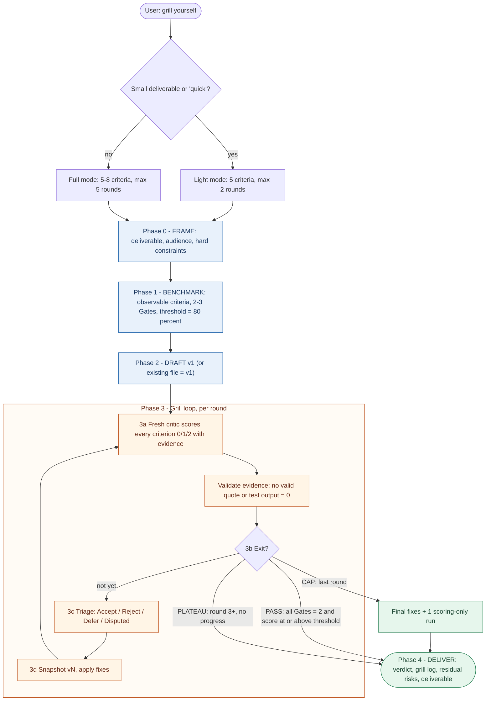
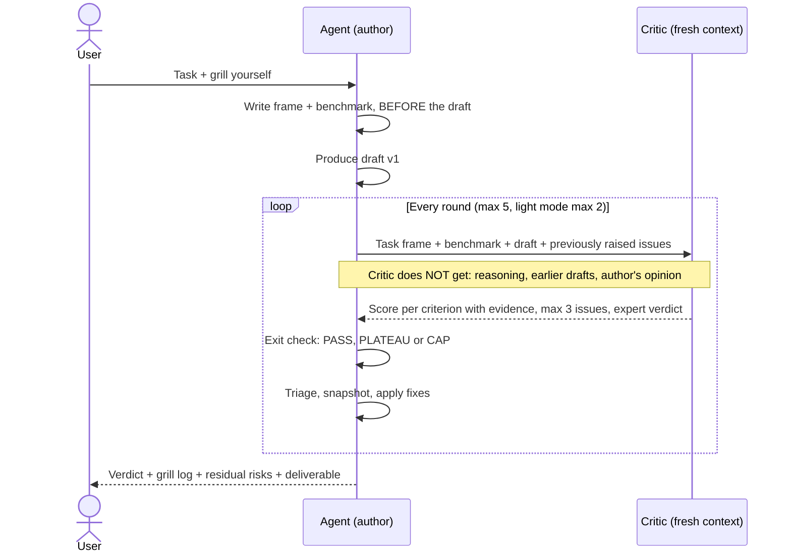

# Grill Myself: an AI skill that stress-tests its own work

> The agent produces something, has it attacked by an **independent critic**, and only stops when it meets a **benchmark defined up front**. Not when it "feels done".

`grill-myself` is an [Agent Skill](https://agentskills.io): one `SKILL.md` file in the open format that Claude, Codex, GitHub Copilot, Cursor, Gemini CLI and other AI tools load natively. For tools without skill support there is a copy-paste route. Use it on a deliverable that has to be right: a Canvas App formula, a Power Automate flow, a PnP script, an HTML dashboard, an architecture plan or documentation.

| | |
|---|---|
| **Version** | 1.1.0 (see [CHANGELOG](CHANGELOG.md)) |
| **Works in** | Claude (Code, Desktop, claude.ai, Cowork), OpenAI Codex, GitHub Copilot, Cursor, Gemini CLI, any [Agent Skills client](https://agentskills.io), plus plain chat apps via [adapters](adapters/) |
| **Cost** | ~230 tokens per session (description), ~5k tokens per invocation + 1 critic run per round |
| **Sibling** | Counterpart of `grill-me`: there the AI grills **you**, here it grills **itself** |
| **License** | [MIT](LICENSE) |

---

## Contents

1. [Why this skill](#1-why-this-skill)
2. [How it works](#2-how-it-works)
3. [Installation](#3-installation)
4. [Usage](#4-usage)
5. [What you get back](#5-what-you-get-back)
6. [Requirements and limitations](#6-requirements-and-limitations)
7. [Updating and maintenance](#7-updating-and-maintenance)
8. [Troubleshooting](#8-troubleshooting)
9. [Repository layout](#9-repository-layout)
10. [License](#10-license)

---

## 1. Why this skill

Ask an AI to "double-check its work" and you usually get a polite confirmation of what it already wrote. This skill breaks that pattern with three hard rules:

| Rule | What it prevents |
|---|---|
| **1. The bar is set before judging.** The benchmark is written before the draft. | Criteria being bent to fit the result afterwards. |
| **2. The critic is not the author.** A fresh critic (subagent, or a second chat) sees only the task, the benchmark and the draft. Never the author's reasoning. | The reviewer being steered by the author's line of thought. |
| **3. The loop has an exit computed from numbers.** `PASS`, `PLATEAU` or `CAP`. | Endless iteration, or stopping because it "looks fine". |

**Use it** for deliverables where a mistake costs time or money: production formulas, flows, scripts that run against a tenant, customer-facing documentation, architecture decisions.

**Don't use it** for quick questions, small fixes or factual answers. Under ~30 lines, the skill itself suggests a lighter mode.

---

## 2. How it works

### 2.1 The process



> Diagram not rendering (e.g. an older Azure DevOps Server)? See [docs/img/flow.svg](docs/img/flow.svg).

### 2.2 Who sees what: critic independence

The key design principle is **information isolation**. The critic deliberately gets less context than the author, so it judges the work and not the intent.



> Fallback: [docs/img/sequence.svg](docs/img/sequence.svg). More detail on scoring, exits and triage in [docs/how-it-works.md](docs/how-it-works.md).

### 2.3 Scoring at a glance

- Every criterion scores **0** (fail), **1** (partial) or **2** (pass), always with **verbatim evidence** from the draft or from a test the critic ran. No evidence = 0.
- **Gates** (2 to 3 per benchmark) are the non-negotiable criteria, e.g. *delegation* for Power Fx or *Try/Catch* for a flow.
- **PASS** = every Gate at 2 **and** total ≥ `ceil(0.8 × max)`.
  Example: 7 criteria → max 14 → PASS from **12/14**, but only if every Gate is at 2.

---

## 3. Installation

The skill is one folder (`grill-myself/` with `SKILL.md` inside). Installing it means putting that folder where your AI tool looks for skills. Pick the route for the tool you use; you can combine routes.

| Route | For | Updates |
|---|---|---|
| [**A. Any Agent Skills tool**](#a-any-agent-skills-tool-codex-copilot-cursor-gemini-cli-claude-code) | Codex, GitHub Copilot, Cursor, Gemini CLI, Claude Code | Run the install script again, or `git pull` for project installs |
| [**B. Claude Code plugin marketplace**](#b-claude-code-via-the-plugin-marketplace) | Claude Code teams | Centrally, via version number |
| [**C. ZIP upload in claude.ai**](#c-claudeai-claude-desktop-and-cowork-zip-upload) | claude.ai, Desktop chat, Cowork | Re-upload, or org sharing |
| [**D. Tools without skill support**](#d-tools-without-skill-support) | Other coding agents, Microsoft 365 Copilot Chat, custom GPTs, Gems | Re-attach `SKILL.md` |

> **In every command below**, replace `<org>`, `<project>` and `<repo>` with the real values of this repository.

### A. Any Agent Skills tool (Codex, Copilot, Cursor, Gemini CLI, Claude Code)

Most tools now share one folder, `.agents/skills/`. Claude Code uses its own, `.claude/skills/`.

| Tool | Personal (all your projects) | Project (commit it, the whole team gets it) |
|---|---|---|
| OpenAI Codex (CLI, IDE, app) | `~/.agents/skills/` | `.agents/skills/` |
| GitHub Copilot (CLI, VS Code, Visual Studio, JetBrains, cloud agent) | `~/.agents/skills/` or `~/.copilot/skills/` | `.agents/skills/`, `.github/skills/` or `.claude/skills/` |
| Cursor | `~/.agents/skills/` or `~/.cursor/skills/` | `.agents/skills/` or `.cursor/skills/` |
| Gemini CLI | `~/.agents/skills/` or `~/.gemini/skills/` | `.agents/skills/` or `.gemini/skills/` |
| Claude Code | `~/.claude/skills/` | `.claude/skills/` |

> Paths checked against each vendor's docs in November 2026. They move: if the skill doesn't show up, check your tool's skills documentation.

The install scripts copy the folder to **both** `.agents/skills/` and `.claude/skills/` by default, which covers every tool above. Each script prints what it will create or replace before it copies.

**macOS / Linux.** Dry run first, then for real:

```bash
./scripts/install.sh --dry-run
```

```bash
./scripts/install.sh
```

Options: `--target agents|claude|all` (default `all`), `--scope personal|project`, `--project PATH`. For a project repository:

```bash
./scripts/install.sh --scope project --project ~/repos/my-project
```

**Windows (PowerShell).** Dry run first, then for real:

```powershell
.\scripts\Install-Skill.ps1 -Scope Personal -WhatIf
```

```powershell
.\scripts\Install-Skill.ps1 -Scope Personal
```

For a project repository: `.\scripts\Install-Skill.ps1 -Scope Project -ProjectPath C:\repos\my-project`. Limit to one folder with `-Target Agents` or `-Target Claude`.

**By hand** (no script):

```bash
mkdir -p ~/.agents/skills && cp -R plugins/grill/skills/grill-myself ~/.agents/skills/
```

Start a **new** session in your tool so it picks up the skill.

### B. Claude Code via the plugin marketplace

This repository is also a Claude Code **plugin marketplace** (`nills-p-skills`) containing one plugin (`grill`) that holds the skill. Everyone gets the same version, and you roll out updates by bumping a version number.

**Step 1: add the marketplace.** In a Claude Code session, run the command for your host:

GitHub:

```text
/plugin marketplace add <org>/<repo>
```

Azure DevOps (use the full HTTPS clone URL; the `owner/repo` shorthand only works for github.com):

```text
/plugin marketplace add https://dev.azure.com/<org>/<project>/_git/<repo>
```

**Step 2: install the plugin.**

```text
/plugin install grill@nills-p-skills
```

**Step 3: verify.** Start a new session (or run `/reload-plugins`) and type `/grill`. You should see `/grill:grill-myself` in the list.

Prefer the shell over a session? That works too:

```bash
claude plugin marketplace add https://dev.azure.com/<org>/<project>/_git/<repo>
```

```bash
claude plugin install grill@nills-p-skills
```

#### Private repository? How authentication works

Claude Code simply runs `git` on your machine, **with interactive prompts disabled**. The marketplace has no token field. Your git must already be signed in before you run the command:

- **Azure DevOps:** clone the repository once manually with `git clone`. Git Credential Manager (bundled with Git for Windows) stores your sign-in, and Claude Code reuses it.
- **GitHub:** run `gh auth login`, then `gh auth setup-git`. No SSH key? Set the environment variable `CLAUDE_CODE_PLUGIN_PREFER_HTTPS=1`.

#### For the whole team at once (optional)

Want everyone working in a given project repository to get this marketplace automatically? Run this **once** in the root of that project repository and commit the `.claude/settings.json` it creates:

```bash
claude plugin marketplace add https://dev.azure.com/<org>/<project>/_git/<repo> --scope project
```

Teammates get the marketplace registered as soon as they trust the folder in Claude Code; after that they only need step 2. For a rollout across all machines (managed settings, auto-update), see [Manage plugins for your organization](https://code.claude.com/docs/en/plugins/org).

### C. claude.ai, Claude Desktop and Cowork (ZIP upload)

**Prerequisite:** *Code execution and file creation* must be enabled (**Settings > Capabilities**). On a Team or Enterprise plan, an owner controls this in **Organization settings > Plugins & skills**.

1. Build the ZIP. It must contain the **folder** `grill-myself/` with `SKILL.md` inside, not just the file.

   Windows:

   ```powershell
   .\scripts\New-SkillPackage.ps1
   ```

   macOS / Linux:

   ```bash
   mkdir -p dist && (cd plugins/grill/skills && zip -r ../../../dist/grill-myself.zip grill-myself)
   ```

2. In claude.ai, go to **Customize > Skills**.
3. Click **+**, then **+ Create skill**, then **Upload a skill**.
4. Select `dist/grill-myself.zip`.
5. Toggle the skill on in your list.

**Sharing within your organization (Team/Enterprise):**

- **Share with colleagues:** click **⋯ > Share** next to the skill (an owner must enable *Share with organization* first). Recipients receive updates automatically.
- **Publish to org:** if your org allows it, an owner can make the skill installed by default or required for everyone.
- **Org sync from a repository:** **Organization settings > Plugins & skills** can sync a marketplace repository directly, but supports **GitHub and GitLab**, not Azure DevOps. If you host on Azure DevOps, use ZIP upload + Share.

> Skills you enable in claude.ai are also synced to Claude Code sessions signed in with the same account.

### D. Tools without skill support

Two thin adapters in [`adapters/`](adapters/). Neither copies the skill text, so they can't drift from `SKILL.md`.

| Your tool | Use | How |
|---|---|---|
| A coding agent that reads `AGENTS.md` (or `CLAUDE.md`, `GEMINI.md`, `.github/copilot-instructions.md`) but not skills | [`adapters/AGENTS.md`](adapters/AGENTS.md) | Install the folder to `.agents/skills/` (route A, project scope), then paste the snippet into your instructions file |
| A chat app: Microsoft 365 Copilot Chat, a custom GPT, a Gemini Gem, a Copilot Studio agent, a Claude Project | [`adapters/chat-prompt.md`](adapters/chat-prompt.md) | Attach `SKILL.md` (or upload it as a knowledge file) and paste the preamble |

---

## 4. Usage

The skill only starts **when you explicitly ask for it**. An ordinary "improve this" deliberately does not trigger it.

| You type | Result |
|---|---|
| "Build this flow and **grill yourself** until it meets the bar" | Starts after producing the draft (every tool) |
| "**Stress-test your answer**" / "**iterate until it meets the bar**" | Starts on your previous answer |
| "Grill yourself, but **quick**" | Light mode: 5 criteria, max 2 rounds |
| "Can you improve this?" | Does **not** start (ordinary improvement) |
| "Grill **me** on this plan" | Does **not** start: that is `grill-me` |

Natural language works everywhere. To call the skill directly:

| Tool | Explicit call |
|---|---|
| Claude Code | `/grill:grill-myself` (plugin) or `/grill-myself` (manual install) |
| Codex | `$grill-myself`, or pick it from `/skills` |
| Cursor | Type `/` in Agent chat and pick `grill-myself` |
| Gemini CLI, GitHub Copilot | Ask in natural language ("grill yourself"); the tool activates the skill (Gemini CLI asks you to approve first) |

**Examples from our stack:**

```text
Write the Patch formula for the request form on the Dataverse table Requests.
2000-row delegation limit, users without a premium license. Grill yourself.
```

```text
Here is my PnP script that cleans up old versions in every document library.
Grill yourself on this existing script, focus on safety and throttling.
```

The skill ships a **starter benchmark** for each deliverable type (UI/HTML, Canvas App/Power Fx, Power Automate, PnP PowerShell, JS/TS/React/PCF, architecture, writing, skills/prompts). The agent tailors it to your task.

---

## 5. What you get back

Always in this order, so the verdict doesn't get buried under a long deliverable:

**1. Verdict**

```text
PASS in 3 rounds (12/14)
```

**2. Grill log**

| Round | Score | Gates | Accepted | Rejected (why) | Deferred / Disputed |
|---|---|---|---|---|---|
| 1 | 8/14 | Delegation: 1, Correctness: 2 | Hoist Filter into With() | Use premium connector (conflicts with licensing constraint) | - |
| 2 | 11/14 | Delegation: 2, Correctness: 2 | IfError around Patch | - | Offline mode (out of scope) |
| 3 | 12/14 | Delegation: 2, Correctness: 2 | - | - | - |

*(illustrative example)*

**3. Residual risks**: failing criteria, deferred and disputed issues, assumptions, and whether the critic actually tested or only read.

**4. The deliverable itself**: exactly the version the reported score was based on.

---

## 6. Requirements and limitations

- **An independent critic needs a separate context.** The skill picks the first option your tool supports:

  | Option | When | Independent? |
  |---|---|---|
  | Subagent tool | Your tool can spawn subagents (e.g. Claude Code, Cowork) | Yes |
  | Separate CLI run | The agent can run shell commands; it asks you once first | Yes |
  | Manual critic | No isolation: you paste each critic prompt into a second chat (any AI tool) | Yes, one copy-paste per round |
  | Self-critique | You'd rather not copy-paste | No: labelled `SELF-CRITIQUE (not independent)` |

- **Cost scales with rounds.** Each round sends draft + benchmark + template to a new critic. The agent states the mode, max rounds and max critic runs before starting.
- **No side effects while testing.** The critic may only test in a sandbox, read-only or dry-run mode. Never against a production tenant, never with real credentials, never anything that sends mail, writes data or deletes. If it can't be tested safely, it reviews statically and says so.
- **The benchmark is not a guarantee.** PASS means "meets the criteria defined up front". Read the residual risks and review it yourself before production.
- **Model quality matters.** The procedure is the same in every tool, but a weaker model follows the scoring and evidence rules less strictly. Check the grill log.

---

## 7. Updating and maintenance

**Changing the skill:** edit `plugins/grill/skills/grill-myself/SKILL.md`. It is the only copy; every route and adapter reads from it.

**Rolling out a new version:**

1. Bump the version in **both** `plugins/grill/.claude-plugin/plugin.json` (`version`) and the `SKILL.md` frontmatter (`metadata.version`), e.g. `1.1.0` → `1.2.0`. Claude Code users do **not** receive the change without the `plugin.json` bump.
2. Record the change in [CHANGELOG.md](CHANGELOG.md).
3. Validate locally:

   ```bash
   claude plugin validate .
   ```

   Optional, for the open spec: the [skills-ref](https://github.com/agentskills/agentskills/tree/main/skills-ref) validator (`skills-ref validate plugins/grill/skills/grill-myself`).

4. Merge to `main` via a pull request.

**Pulling an update as a user:**

- **Route A:** run the install script again (personal), or `git pull` in the project that holds `.agents/skills/` (project).
- **Route B:** `/plugin marketplace update nills-p-skills`, or enable automatic updates: `/plugin` > **Marketplaces** > `nills-p-skills` > **Enable auto-update**.
- **Route C:** re-upload the new ZIP, unless you received the skill via **Share**: then the update arrives automatically.
- **Route D:** re-attach or re-upload the new `SKILL.md`.

**Editing the diagrams:** the sources live in `docs/diagrams/*.mmd`. Edit them there, copy the code into this README, and re-export the SVG fallback (e.g. with the [Mermaid Live Editor](https://mermaid.live) or `npx @mermaid-js/mermaid-cli`).

---

## 8. Troubleshooting

| Symptom | Cause | Fix |
|---|---|---|
| Skill doesn't appear in Codex, Copilot, Cursor or Gemini CLI | Installed only to `.claude/skills/`, or the session was already open | Install with `--target agents` (or the default `all`) and start a new session |
| Skill doesn't appear in Claude Code | Installed only to `.agents/skills/` | Install with `--target claude` (or the default `all`), or use route B |
| `marketplace add` fails on Azure DevOps with an auth error | Git wants to prompt for sign-in, but Claude Code disallows prompts | Clone the repository once manually so Git Credential Manager stores your sign-in |
| `owner/repo` can't find the Azure DevOps repository | The shorthand always means github.com | Use the full `https://dev.azure.com/...` URL |
| `Plugin "grill-myself" not found in marketplace` | You installed the skill name instead of the plugin name | `/plugin install grill@nills-p-skills` |
| Update doesn't arrive in Claude Code | `version` was not bumped | Bump the version in `plugin.json`, then `/plugin marketplace update` |
| ZIP upload in claude.ai fails | ZIP contains only `SKILL.md`, or folder name ≠ `name` in the frontmatter | Use `New-SkillPackage.ps1` or the `zip` command above |
| Skill doesn't start on its own | By design: it only triggers on explicit requests | Say "grill yourself" or use the explicit call for your tool |
| Verdict shows `SELF-CRITIQUE (not independent)` | No subagent tool or shell in this environment | Choose **Manual critic** when offered, or use a tool with subagents |
| Mermaid diagram shows as code in Azure DevOps | Older Azure DevOps Server version | Use the SVGs in `docs/img/` |

---

## 9. Repository layout

```text
.
├── .claude-plugin/
│   └── marketplace.json          # Claude Code marketplace "nills-p-skills" (route B)
├── plugins/
│   └── grill/
│       ├── .claude-plugin/
│       │   └── plugin.json       # Plugin name + version (bump on every release)
│       └── skills/
│           └── grill-myself/
│               └── SKILL.md      # THE skill: single source of truth for every tool
├── adapters/
│   ├── AGENTS.md                 # Route D: snippet for tools that read AGENTS.md but not skills
│   └── chat-prompt.md            # Route D: preamble for chat apps, GPTs, Gems, Copilot agents
├── scripts/
│   ├── install.sh                # Route A (macOS/Linux): copy to .agents/ and/or .claude/ skills
│   ├── Install-Skill.ps1         # Route A (Windows): same, supports -WhatIf
│   └── New-SkillPackage.ps1      # Route C: build dist/grill-myself.zip
├── docs/
│   ├── how-it-works.md           # Deeper explanation: scoring, exits, triage
│   ├── diagrams/*.mmd            # Mermaid sources for the diagrams
│   └── img/*.svg                 # Rendered fallback
├── CHANGELOG.md
├── LICENSE                       # MIT
└── README.md
```

`SKILL.md` lives in exactly **one** place. Every install route and adapter reads from that same file, so versions can't drift apart.

---

## 10. License

[MIT](LICENSE) © 2026 Nills Parmentier. Use it, fork it, adapt the benchmarks to your own stack.
